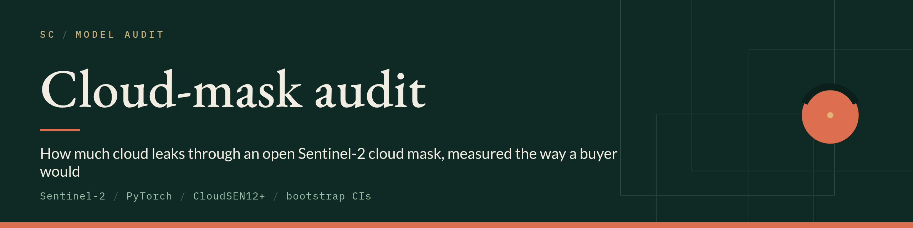
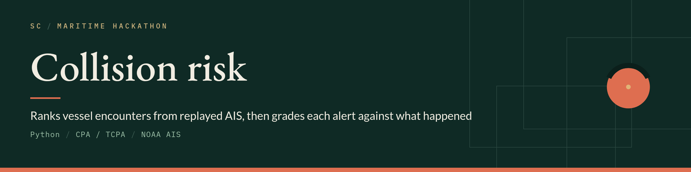
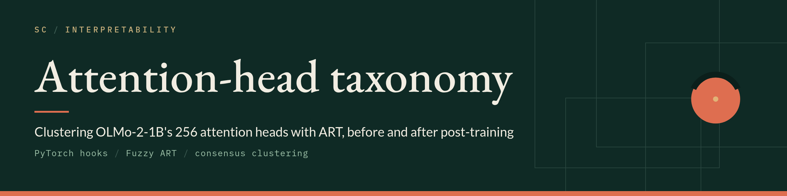
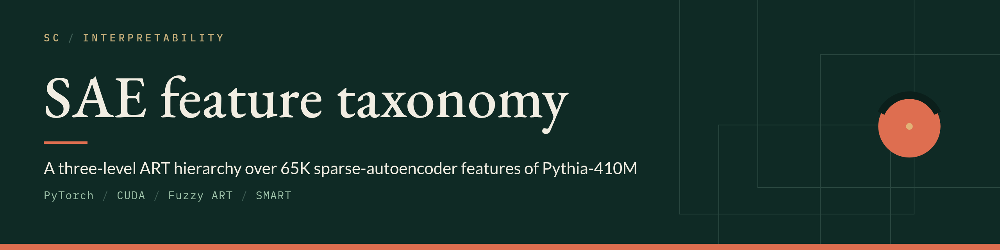

I build AI tools that come with the evidence for their claims: model monitoring, audits, and evaluation. My Ph.D. research at Missouri S&T is on Adaptive Resonance Theory, adversarial robustness, and continual learning.

<table>
<tr>
<td width="50%"></td>
<td width="50%"></td>
</tr>
<tr>
<td width="50%"></td>
<td width="50%"></td>
</tr>
</table>

**Papers**: *Robustness of Fuzzy ARTMAP to Adversarial Attacks and Progressive Adversarial Training for Streaming Learning*, IJCNN 2026 ([extended version on arXiv](https://arxiv.org/abs/2605.06902)). Two more on ART-based quantization and generative modeling are in submission.

[shanecairns.com](https://shanecairns.com) · [shane@shanecairns.com](mailto:shane@shanecairns.com) · [LinkedIn](https://www.linkedin.com/in/shane-c-b5b948135/)
