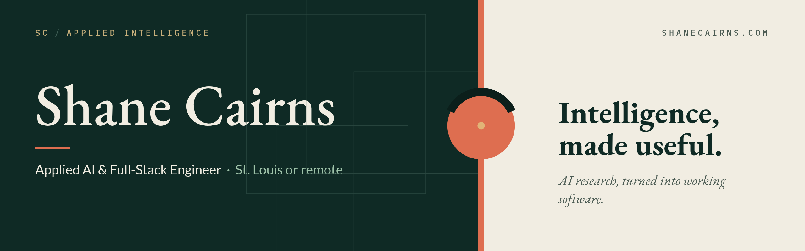

I build AI tools that come with the evidence for their claims: model monitoring, audits, and evaluation. My Ph.D. research at Missouri S&T is on Adaptive Resonance Theory, adversarial robustness, and continual learning.

| | |
|---|---|
| [**Vigil**](https://github.com/syre-ai/vigil) | Drift, novelty, and recall monitoring for a satellite-imagery aircraft detector, with an analyst review loop. FastAPI, React, DINOv2 |
| [**Cloud-mask audit**](https://github.com/syre-ai/cloudmask-acceptance-audit) | An independent acceptance audit of an open Sentinel-2 cloud mask: 960 expert-labeled scenes, six baselines, stress tests |
| [**Collision risk**](https://github.com/syre-ai/collision-risk) | Vessel encounter ranking from replayed AIS, with each alert graded against what happened. Hackathon build |
| [**Attention-head taxonomy**](https://github.com/syre-ai/art-attention-heads) | Clustering OLMo-2-1B's attention heads with ART across post-training checkpoints |
| [**SAE feature taxonomy**](https://github.com/syre-ai/ART-SAE-taxonomy) | GPU Fuzzy ART hierarchy over 65K sparse-autoencoder features of Pythia-410M |

**Papers**: *Robustness of Fuzzy ARTMAP to Adversarial Attacks and Progressive Adversarial Training for Streaming Learning*, IJCNN 2026 ([extended version on arXiv](https://arxiv.org/abs/2605.06902)). Two more on ART-based quantization and generative modeling are in submission.

[shanecairns.com](https://shanecairns.com) · [shane@shanecairns.com](mailto:shane@shanecairns.com) · [LinkedIn](https://www.linkedin.com/in/shane-c-b5b948135/)
